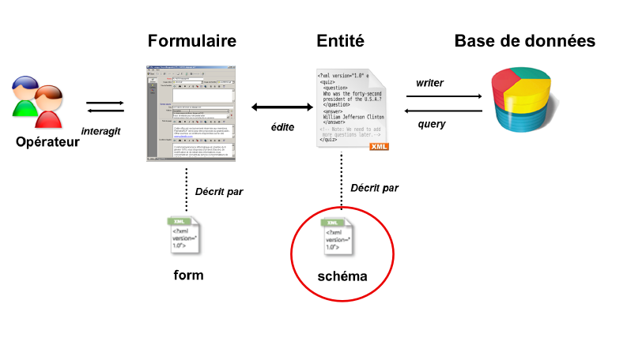

# Prise en main des schémas {#about-schema-reference}

## Qu’est-ce qu’un schéma ? {#what-is-a-schema}

Ce chapitre explique comment configurer des schémas d’extension afin d’étendre le modèle conceptuel de données de la base de données Adobe Campaign.

Pour une meilleure compréhension des tables intégrées de Campaign et de leur interaction, consultez la section [Modèle de données Campaign Classic](https://experienceleague.adobe.com/fr/docs/campaign/campaign-v8/developer/datamodel){target="_blank"} (documentation de Campaign v8).

Dans Adobe Campaign, la structure physique et logique des données véhiculées dans l’application est décrite en XML. Un **schéma** est un document XML lié à une table de base de données. Il définit la structure des données et décrit la définition SQL de la table :

* le nom de la table,
* des champs ;
* des index ;
* les liens avec les autres tables,

mais aussi la structure XML utilisée pour stocker les données :

* Eléments et attributs
* la hiérarchie entre les éléments,
* les types des éléments et des attributs,
* Les valeurs par défaut
* les libellés, les descriptions et autres propriétés.

Les schémas vous permettent de définir une entité dans la base de données. À chaque entité correspond un schéma.

L&#39;illustration suivante montre la place des schémas dans le système de données d&#39;Adobe Campaign :

Dans le cadre de la transition de Campaign v7 vers v8, la documentation de Campaign Classic a été rationalisé et réorganisé. Les fonctionnalités communes sont désormais disponibles exclusivement dans le jeu de documentation de Campaign v8. Pour en savoir plus sur la syntaxe et l’identification des schémas, consultez la [documentation de Campaign v8](https://experienceleague.adobe.com/fr/docs/campaign/campaign-v8/developer/schemas-forms/schemas){target=_blank}.

{target=_blank}
