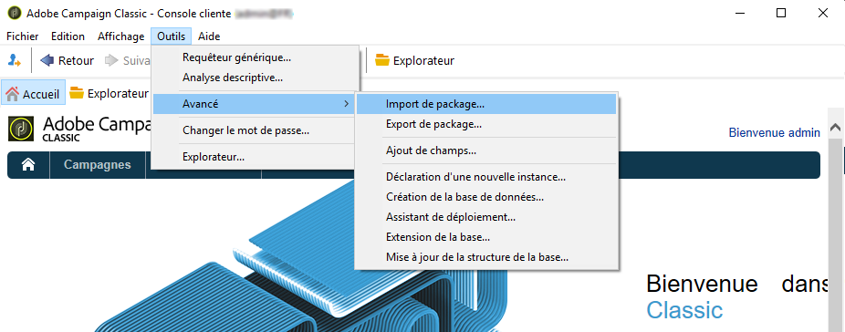
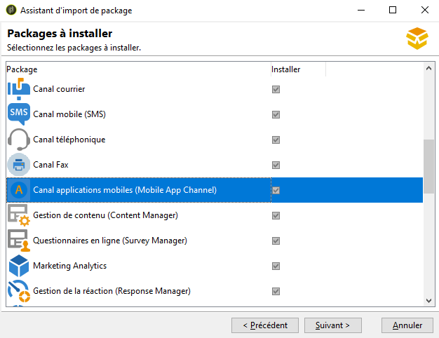
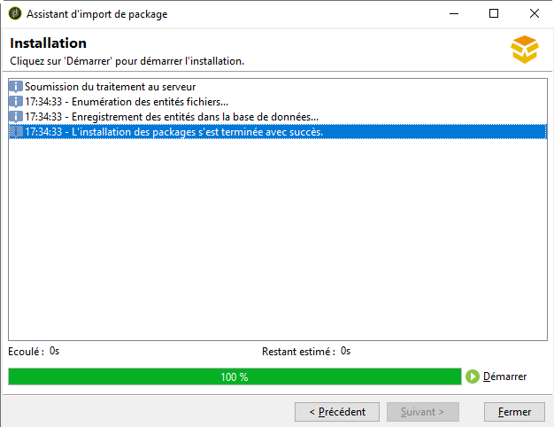

# Commencer avec le canal d’application mobile{#about-mobile-app-channel}

Avec Adobe Campaign, créez des diffusions de notifications push pour envoyer des messages personnalisés aux utilisateurs et utilisatrices de votre application mobile.

>[!NOTE]
>
>Dans le cadre de la transition de Campaign v7 vers v8, la documentation de Campaign Classic a été rationalisé et réorganisé. Les fonctionnalités communes sont désormais disponibles exclusivement dans le jeu de documentation de Campaign v8. Pour en savoir plus sur le canal de notification push, consultez la documentation [Campaign v8](https://experienceleague.adobe.com/fr/docs/campaign/campaign-v8/send/push/push){target=_blank}.
>
>{target=_blank}

Les informations suivantes concernent uniquement Campaign Classic.

+++ **Installation du package**

 [Découvrez comment installer le package d’application mobile en vidéo](https://experienceleague.adobe.com/docs/campaign-classic-learn/tutorials/sending-messages/push-channel/installing-the-mobile-app-channel.html?lang=fr#sending-messages)

En tant que client hybride/hébergé, contactez l&#39;équipe d&#39;[Assistance clientèle d&#39;Adobe](https://helpx.adobe.com/fr/enterprise/admin-guide.html/enterprise/using/support-for-experience-cloud.ug.html) pour accéder au canal de notifications push dans Campaign.

En tant que client on-premise, vous devez installer un package natif.

>[!CAUTION]
>
>Pour en savoir plus sur les packages natifs de Campaign, les bonnes pratiques et les recommandations, consultez [cette page](../../installation/using/installing-campaign-standard-packages.md).

Les étapes d&#39;installation sont les suivantes :

1. Accédez à l’assistant d’import de package depuis le menu **[!UICONTROL Outils > Avancé > Import de package]** de la console cliente Adobe Campaign.

   

1. Sélectionnez **[!UICONTROL Installer un package standard]**.

1. Dans la liste qui s&#39;affiche, cochez **[!UICONTROL Canal des applications mobiles]**.

   

1. Cliquez sur **[!UICONTROL Suivant]** puis **[!UICONTROL Démarrer]** pour commencer l&#39;installation du package.

   Une fois les packages installés, la barre de progression indique **100 %**. De plus, les logs de l&#39;installation contiennent le message suivant : **[!UICONTROL L&#39;installation des packages s&#39;est terminée avec succès]**.

   

1. **[!UICONTROL Fermez]** la fenêtre d&#39;installation.

Une fois cette étape effectuée, vous pouvez configurer vos applications Android et iOS. Consultez la [documentation](https://experienceleague.adobe.com/docs/campaign/campaign-v8/send/push/push.html?lang=fr){target="_blank"} de Campaign v8.

+++

+++ **Résolution des problèmes**

Si votre appareil mobile est connecté en Wi-Fi et que vous ne recevez pas les notifications, vérifiez que les ports FCM/APN ne sont pas bloqués par votre pare-feu.

**Android** : l’appareil mobile se connecte aux serveurs FCM sur les ports 5228 à 5230. Vous devez donc configurer votre pare-feu afin qu’il autorise la connexion à FCM. Les ports à ouvrir sont : 5228 (le plus fréquemment utilisé), 5229 et 5230.

**iOS** :

Connecteur HTTP/2 : vous devez autoriser les communications à destination et en provenance des serveurs suivants :

* api.push.apple.com : port 443
* api.development.push.apple.com : port 443

>[!NOTE]
>
>Pour plus d’informations sur les deux connecteurs, consultez la [documentation](https://experienceleague.adobe.com/docs/campaign/campaign-v8/send/push/push-settings.html?lang=fr){target="_blank"} de Campaign v8.

+++
