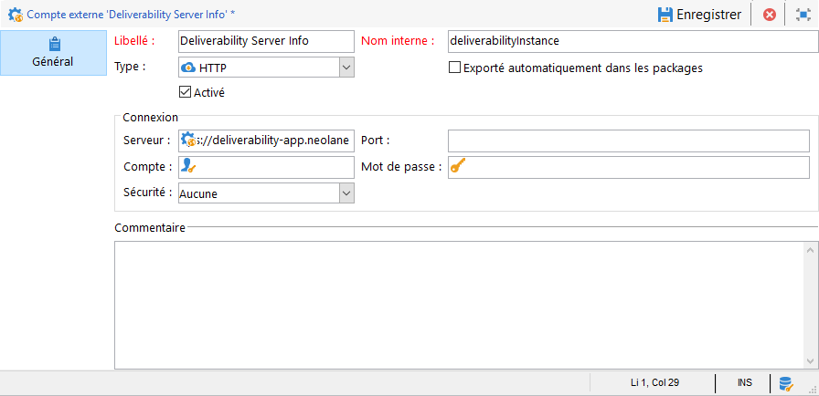

# Rendu de la boîte de réception{#inbox-rendering}

Adobe Campaign tire parti de la solution web de test d&#39;email [Litmus](https://litmus.com/email-testing) pour capturer les rendus d&#39;email et les rendre disponibles dans un rapport dédié.

Dans le cadre de la transition de Campaign v7 vers v8, la documentation de Campaign Classic a été rationalisé et réorganisé. Les fonctionnalités communes sont désormais disponibles exclusivement dans le jeu de documentation de Campaign v8. Pour en savoir plus sur l&#39;inbox rendering, consultez la documentation de [Campaign v8](https://experienceleague.adobe.com/en/docs/campaign/campaign-v8/send/deliverability-management/inbox-rendering){target=_blank}.

[](https://experienceleague.adobe.com/en/docs/campaign/campaign-v8/send/deliverability-management/inbox-rendering){target=_blank}

## Activation de l&#39;Inbox rendering {#activating-inbox-rendering}

[!BADGE On-premise et hybride]{type=Caution url="https://experienceleague.adobe.com/fr/docs/campaign-classic/using/installing-campaign-classic/architecture-and-hosting-models/hosting-models-lp/hosting-models" tooltip="S’applique uniquement aux déploiements on-premise et hybrides"}

Pour les clients hébergés et hybrides, l&#39;Inbox rendering est configuré pour votre instance par l&#39;assistance technique et les consultants d&#39;Adobe. Pour plus d&#39;informations, contactez votre chargé de compte Adobe.

Pour les installations sur site, suivez la procédure ci-dessous pour configurer l&#39;Inbox rendering.

1. Installez le package **[!UICONTROL Inbox rendering (IR)]** via le menu **[!UICONTROL Outils]** >**[!UICONTROL Avancé]** > **[!UICONTROL Import de package]**. Pour plus d&#39;informations, voir la section [Installer des packages standard Campaign Classic](../../installation/using/installing-campaign-standard-packages.md).
1. Configurez un compte externe de type HTTP via le nœud **[!UICONTROL Administration]** > **[!UICONTROL Plateforme]** > **[!UICONTROL Comptes externes]**. Pour plus d&#39;informations, consultez la section [Créer un compte externe](../../installation/using/external-accounts.md#creating-an-external-account).
1. Définissez les paramètres du compte externe comme suit :
   * **[!UICONTROL Libellé]** : informations relatives au serveur de délivrabilité
   * **[!UICONTROL Nom interne]** : deliverabilityInstance
   * **[!UICONTROL Type]** : HTTP
   * **[!UICONTROL Serveur]** : https://deliverability-app.neolane.net/deliverability
   * **[!UICONTROL Chiffrement]** : Aucun
   * Cochez l&#39;option **[!UICONTROL Activé]**.

   

1. Accédez au nœud **[!UICONTROL Administration]** > **[!UICONTROL Plateforme]** > **[!UICONTROL Options]**. Recherchez l&#39;option **[!UICONTROL DmRendering_cuid]** et contactez l&#39;assistance technique pour obtenir l&#39;identifiant des rapports de diffusion qui doit être copié dans le champ **[!UICONTROL Valeur (texte)]**.
1. Modifiez le fichier **serverConf.xml** pour autoriser un appel au serveur Litmus. Ajoutez la ligne suivante à la section `<urlPermission>` :

   ```
   <url dnsSuffix="deliverability-app.neolane.net" urlRegEx="https://.*"/>
   ```

1. Chargez de nouveau la configuration à l&#39;aide de la commande suivante :

   ```
   nlserver config -reload
   ```

>[!NOTE]
>
>Vous devrez peut-être vous déconnecter de la console et vous reconnecter pour pouvoir utiliser l&#39;Inbox rendering.
