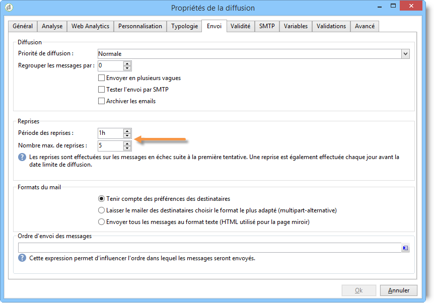
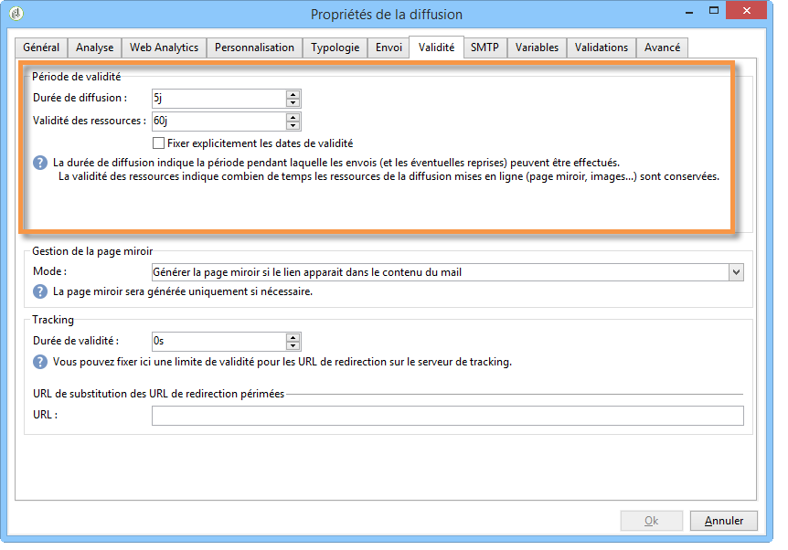

# Configurer et envoyer la diffusion {#configuring-and-sending-the-delivery}

Cette page décrit les paramètres d’envoi de diffusion spécifiques aux installations on-premise et hybrides de Campaign Classic v7.

Dans le cadre de la transition de Campaign v7 vers v8, le jeu de documentation de Campaign Classic a été rationalisé et réorganisé. Les fonctionnalités communes sont désormais disponibles exclusivement dans le jeu de documentation de Campaign v8. Pour en savoir plus sur les paramètres d’envoi des diffusions, consultez la documentation de [Campaign v8](https://experienceleague.adobe.com/en/docs/campaign/campaign-v8/send/validate/configure-and-send){target=_blank}.

{target=_blank}

## Paramètres supplémentaires de diffusion {#delivery-additiona-parameters}

Avant d’envoyer la diffusion, vous pouvez définir les paramètres d’envoi dans les propriétés de la diffusion, via l’onglet **[!UICONTROL Diffusion]**.

* **[!UICONTROL Tester la diffusion via SMTP]** : cette option vous permet de tester la diffusion par SMTP. La diffusion est traitée jusqu’à la connexion au serveur SMTP mais n’est pas envoyée : pour chaque destinataire de la diffusion, Campaign se connecte au serveur du fournisseur SMTP, exécute la commande SMTP RCPT TO et ferme la connexion avant la commande SMTP DATA.

  >[!NOTE]
  >
  >* Cette option ne doit pas être définie en midsourcing.
  >
  >* Pour en savoir plus sur la configuration du serveur SMTP, voir [cette section](../../installation/using/configure-delivery-settings.md).

## Configuration des reprises {#configuring-retries}

>[!IMPORTANT]
>
>Pour les installations hébergées ou hybrides, si vous avez effectué une mise à niveau vers le [MTA amélioré](sending-with-enhanced-mta.md), les paramètres de reprise de la diffusion ne sont plus utilisés par Campaign. Les reprises des rebonds temporaires et l’intervalle qui les sépare sont déterminés par le MTA amélioré en fonction du type et de la gravité des réponses des rebonds provenant du domaine de messagerie du message.

Pour les installations on-premise et les installations hébergées/hybrides utilisant l’ancien MTA de Campaign, la section centrale de l’onglet **[!UICONTROL Diffusion]** pour les paramètres de diffusion indique le nombre de reprises à effectuer le lendemain de la diffusion et le délai minimal entre celles-ci.

Par défaut, cinq reprises sont planifiées le premier jour de l’envoi, avec un intervalle minimum d’une heure, réparties sur les 24h de la journée. Les jours suivants, une reprise par jour est programmée jusquʼà la date limite de la diffusion, définie dans lʼonglet **[!UICONTROL Validité]**. Consultez la section [Définition de la période de validité](#defining-validity-period).

## Définition de la période de validité {#defining-validity-period}

Une fois la diffusion lancée, les messages (et les éventuelles reprises) peuvent être envoyés jusqu&#39;à la limite de la diffusion. Elle est indiquée dans les propriétés de la diffusion, à partir de l&#39;onglet **[!UICONTROL Validité]**.

* Le champ **[!UICONTROL Durée de diffusion]** permet de saisir la limite pour les reprises globales de diffusion. Concrètement, Adobe Campaign diffuse les messages à partir de la date de début. Puis, pour les messages en erreur uniquement, des reprises régulières et paramétrables sont effectuées tant que la limite de validité n’est pas atteinte.

  >[!IMPORTANT]
  >
  >Pour les installations hébergées ou hybrides, si vous avez effectué une mise à niveau vers le [MTA amélioré](sending-with-enhanced-mta.md), le paramètre **[!UICONTROL Durée de diffusion]** des diffusions Campaign ne sera utilisé que s’il est défini sur **3,5 jours ou moins**. Si vous définissez une valeur supérieure à 3,5 jours, elle ne sera pas prise en compte.

* **Limite de validité des ressources** : le champ **[!UICONTROL Limite de validité]** est utilisé pour les ressources téléchargées, principalement pour la page miroir et les images. Les ressources de cette page ont une durée de validité limitée (afin d&#39;économiser de l&#39;espace disque).

  Les valeurs dans ce champ peuvent être exprimées dans les unités suivantes : **s** pour les secondes, **m** pour les minutes, **h** pour les heures, **j** pour les jours (par défaut), **a** pour les années.
