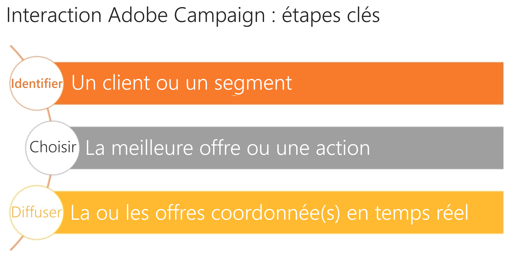

# Interaction et la gestion des offres{#interaction-and-offer-management}

Interaction vous permet de répondre en temps réel lors d’une interaction avec une personne contact donnée (client ou cliente, ou cible) en lui faisant une ou plusieurs offres adaptées. Il peut s’agir, par exemple, de messages de communication simples, d’offres spéciales sur un ou plusieurs produits ou d’un service.

Les offres sont proposées à un contact à l&#39;occasion d&#39;un contact entrant (via un site web ou un centre d&#39;appels) ou sortant (via une diffusion par email, courrier ou SMS dans le cadre d&#39;une campagne marketing).

Vous pouvez créer un catalogue d’offres qui sert d’interface avec les canaux entrants et sortants pour sélectionner la meilleure offre à envoyer à une personne contact dans un contexte donné. La pertinence de l’offre pour une personne destinataire est basée sur des règles d’éligibilité. La sélection d&#39;une offre à partir d&#39;un ensemble d&#39;offres pertinentes est déterminée à l&#39;aide de règles de priorité. Les règles de présentation des offres prennent en compte l’historique des échanges de la personne contact et évitent de lui envoyer plusieurs fois la même offre.

Interaction vous permet de créer et de gérer un catalogue d’offres, et de configurer les règles d’éligibilité et les thèmes d’application qui lui sont associés. Selon le canal choisi, le contenu de l’offre peut être personnalisé grâce à différentes fonctions de rendu. Enfin, vous pouvez utiliser le module de simulation pour calculer l’impact d’une présentation des offres.

Dans le cadre de la transition de Campaign v7 vers v8, le jeu de documentation de Campaign Classic a été rationalisé et réorganisé. Les fonctionnalités communes sont désormais disponibles exclusivement dans le jeu de documentation de Campaign v8. Pour en savoir plus sur Interaction, consultez la documentation de [Campaign v8](https://experienceleague.adobe.com/fr/docs/campaign/campaign-v8/offers/interaction){target=_blank}.

{target=_blank}

Cette section couvre uniquement les fonctionnalités d’interaction qui ne sont pas décrites dans la documentation de Campaign v8 : [simulation de l’offre](about-offers-simulation.md), [présentation de l’offre](managing-offer-presentation.md), [validation de l’offre](approving-and-activating-an-offer.md), [modèles d’offre](managing-offer-templates.md) et [paramètres avancés](using-advanced-parameters.md).

 Pour vous familiariser avec la fonctionnalité d’interaction et les terminologies utilisées dans Interaction de Campaign, regardez [cette vidéo](https://helpx.adobe.com/campaign/classic/how-to/acs-overview.html?playlist=/ccx/v1/collection/product/campaign/classic/segment/digital-marketers/explevel/intermediate/applaunch/get-started/collection.ccx.js&ref=helpx.adobe.com).

## Rubriques connexes :

| Pages utiles | Autres ressources |
|---|---|
| [Étapes d’implémentation d’Interaction](https://experienceleague.adobe.com/fr/docs/campaign/campaign-v8/offers/interaction){target="_blank"} (documentation de Campaign v8) | [Test de la distribution des offres](../../interaction/using/about-offers-simulation.md) |
| [Environnements en ligne/édition](https://experienceleague.adobe.com/fr/docs/campaign/campaign-v8/offers/interaction-settings/interaction-env){target="_blank"} (documentation de Campaign v8) | [Ajout d’une offre dans un e-mail](https://experienceleague.adobe.com/fr/docs/campaign/campaign-v8/offers/interaction-send-offers){target="_blank"} (documentation de Campaign v8) |
| [Création d&#39;emplacements](https://experienceleague.adobe.com/fr/docs/campaign/campaign-v8/offers/interaction-settings/interaction-offer-spaces){target="_blank"} (documentation de Campaign v8) | [Cas pratique : ajouter une offre dans un site web](../../interaction/using/offers-on-an-inbound-channel.md) |
