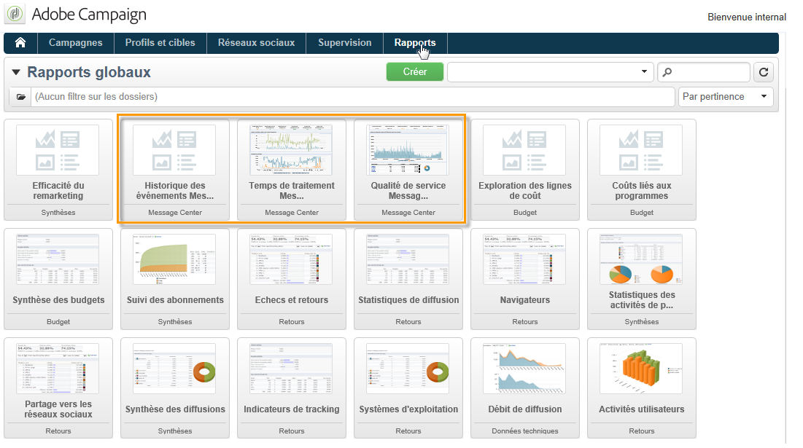

# Accès aux rapports des messages transactionnels {#about-transactional-messaging-reports}

Adobe Campaign propose plusieurs rapports qui permettent de contrôler l&#39;activité et le bon fonctionnement des instances d&#39;exécution.

Ces rapports Message Center sont accessibles à partir de l&#39;onglet **[!UICONTROL Rapports]** de l&#39;**instance de pilotage**.

