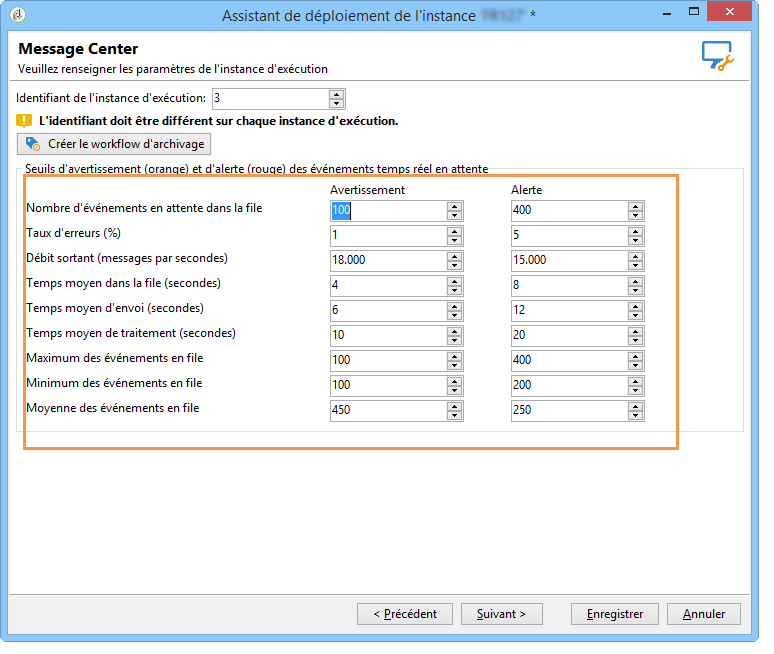

# Configurations supplémentaires {#mc-additional-configurations}

Cette page présente les configurations supplémentaires pour les messages transactionnels dans Campaign Classic v7.

>[!NOTE]
>
>Dans le cadre de la transition de Campaign v7 vers v8, la documentation de Campaign Classic a été rationalisé et réorganisé. Les fonctionnalités communes sont désormais disponibles exclusivement dans le jeu de documentation de Campaign v8. Pour en savoir plus sur la purge des événements de messagerie transactionnelle et les workflows techniques, consultez la [documentation de Campaign v8](https://experienceleague.adobe.com/fr/docs/campaign/campaign-v8/config/settings/transactional-msg-settings){target=_blank}.
>
>[](https://experienceleague.adobe.com/fr/docs/campaign/campaign-v8/config/settings/transactional-msg-settings){target=_blank}

## Surveillance des seuils {#monitoring-thresholds}

Vous pouvez configurer les seuils d’avertissement (orange) et d’alerte (rouge) des indicateurs qui apparaissent dans les rapports **Niveau de service du centre de messages** et **Temps de traitement du centre de messages** (consultez la section [Accéder aux rapports des messages transactionnels](https://experienceleague.adobe.com/fr/docs/campaign/campaign-v8/send/real-time/event/delivery-execution){target="_blank"} (documentation de Campaign v8)).

Pour ce faire, procédez comme suit :

1. Ouvrez l&#39;assistant de déploiement sur l&#39;**instance d&#39;exécution**.

1. Accédez à la page **[!UICONTROL Message Center]**.

1. Utilisez les flèches pour modifier les seuils.

   

>[!NOTE]
>
>Le nombre d&#39;événements en attente dans la file est affiché dans la section [Indicateurs système](../../production/using/monitoring-processes.md#system-indicators) de la page de surveillance des processus Adobe Campaign. Pour plus d&#39;informations sur l&#39;assistant de déploiement, consultez [cette section](../../installation/using/deploying-an-instance.md#deployment-assistant).

## Workflows techniques {#technical-workflows}

Vous devez vous assurer que les workflows techniques de l&#39;instance de pilotage et des différentes instances d&#39;exécution sont bien créés et démarrés avant de procéder au déploiement des modèles de messages transactionnels.

### Planning du workflow d’archivage

Évitez de modifier le planning du **workflow d’archivage** qui s’exécute sur l’instance de pilotage. Sinon, certaines données de tracking extraites de l’instance d’exécution peuvent être perdues.

Si vous modifiez le planning du workflow d’archivage, vous devez également modifier le planning du **workflow de tracking** sur l’instance d’exécution pour qu’il corresponde au planning du workflow d’archivage sur l’instance de pilotage.

## Configuration du multibranding {#configuring-multibranding}

Cette section présente une solution pour configurer le tracking et les URL de page miroir par marque pour les messages transactionnels dans Adobe Campaign.

### Note de compatibilité {#compatibility-note}

Cette configuration du branding héritée n’est pas compatible avec le nouveau modèle de [branding centralisé](https://experienceleague.adobe.com/fr/docs/campaign-web/v8/conf/branding/branding-gs.html?lang=fr){target="_blank"} introduit dans Campaign v8.

Si votre environnement existant utilise cette configuration héritée, elle ne peut pas être migrée directement vers le nouveau modèle de branding centralisé. Une nouvelle implémentation complète des paramètres de branding est nécessaire pour adopter le nouveau système.

### Conditions préalables requises {#prerequisites}

* Tous les hôtes doivent être ajoutés au fichier de configuration de l&#39;instance (`config-<instance>.xml`).
* Un sous-domaine doit être affecté à chaque marque.
* Si le tracking web est réalisé sur les pages HTTPS, vous devez disposer d&#39;un certificat HTTPS pour chacune des marques.

Pour configurer le multibranding, vous devez configurer les instances d&#39;exécution et l&#39;instance de pilotage.

### Instance d&#39;exécution {#execution-instance}

Sur la ou les instances d&#39;exécution, procédez comme suit :

1. Créez un compte externe par marque.

   >[!NOTE]
   >
   >Découvrez comment créer un compte externe de type instance d&#39;exécution dans [cette section](../../message-center/using/configuring-instances.md#control-instance).

1. Étendez le schéma nms:extAccount pour ajouter l’URL de tracking :

   ```
   <attribute advanced="true" desc="URL of the tracking servers" label="Tracking server URL"
   length="100" name="trackingURL" type="string"/>
   ```

   >[!NOTE]
   >
   >Découvrez comment étendre un schéma existant dans la section [Extension d’un schéma](../../configuration/using/extending-a-schema.md).

1. Modifiez le formulaire nms:extAccount :

   ```
   <container label="Message domain branding" type="frame">
        <static type="help"> These parameters are used to override the DNS alias and addresses used during message delivery. When not populated, the values of the 'NmsServer_MirrorPageUrl' and 'NmsEmail_DefaultErrorAddr' options are used.</static>
        <input xpath="@mirrorURL"/>
        <input xpath="@trackingURL"/>
        <input img="nms:sendemail.png" menuId="deliveryMenuBuilder" type="scriptEdit">
               xpath="errorAddress"/>
      </container>
   ```

1. Modifiez les options NmsTracking_OpenFormula et NmsTracking_ClickFormula afin d&#39;utiliser le compte externe au lieu d&#39;une option globale.

   Pour cela, remplacez :

   ```
   <%@ include option='NmsTracking_ServerUrl' %>
   ```

   par :

   ```
   <%@ value object="provider" xpath="@trackingURL" %>
   ```

   >[!IMPORTANT]
   >
   >Ces modifications peuvent entraîner des conflits lors de la mise à niveau. Vous devrez peut-être fusionner manuellement ces formules avec leur nouvelle version.

### Instance de pilotage {#control-instance}

Sur l&#39;instance de pilotage, vous devez lier les modèles de diffusion et les comptes externes.

Pour ce faire, procédez comme suit :

1. Créez un compte externe par marque avec le même nom interne que celui défini sur l&#39;[instance d&#39;exécution](#execution-instance) (étape 1).

1. Créez un modèle de diffusion par marque. Consultez la [documentation de Campaign v8](https://experienceleague.adobe.com/fr/docs/campaign/campaign-v8/send/create-templates.html?lang=fr){target="_blank"}.

1. Dans les **[!UICONTROL Propriétés]** du modèle de diffusion, définissez le routage sur le compte externe de la marque.
