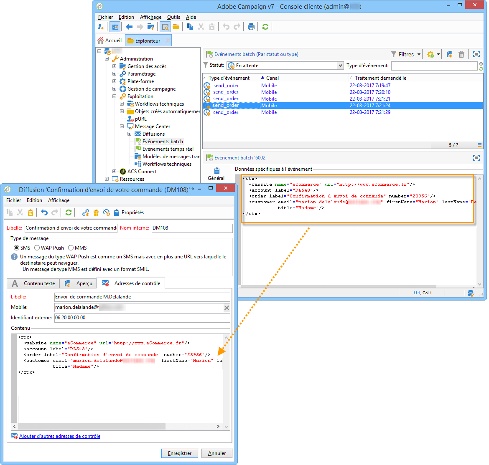
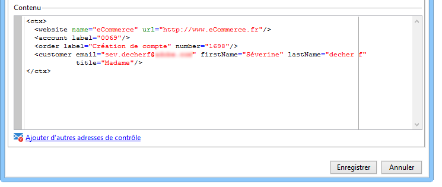

# Test des modèles de message transactionnel {#testing-message-templates}

Une fois que votre [modèle de message](https://experienceleague.adobe.com/fr/docs/campaign/campaign-v8/send/real-time/transactional-template){target="_blank"} (documentation de Campaign v8) est prêt, suivez les étapes ci-dessous pour le prévisualiser et le tester.

Dans le cadre de la transition de Campaign v7 vers v8, le jeu de documentation de Campaign Classic a été rationalisé et réorganisé. Les fonctionnalités communes sont désormais disponibles exclusivement dans le jeu de documentation de Campaign v8. Pour savoir comment ajouter des adresses de contrôle, prévisualiser un message transactionnel et envoyer un BAT, consultez la [documentation de Campaign v8](https://experienceleague.adobe.com/fr/docs/campaign/campaign-v8/send/real-time/transactional-template#test-message-template){target=_blank}.

{target=_blank}

## Données de personnalisation {#personalization-data}

Il est possible d’utiliser des données dans le modèle de message pour tester la personnalisation des messages transactionnels. Cette fonctionnalité est utilisée pour générer une prévisualisation ou envoyer un BAT. Vous pouvez également afficher le rendu du message pour différents fournisseurs d&#39;accès Internet. Pour plus d&#39;informations, consultez la section [Inbox rendering](../../delivery/using/inbox-rendering.md).

Ces données ont pour but de tester vos messages avant leur diffusion finale. Ces messages ne correspondent pas aux données réelles à traiter. Cependant, la structure XML doit être identique à celle de l’événement stocké dans l’instance d’exécution, comme illustré ci-dessous :

Ces informations permettent de personnaliser le contenu du message à l&#39;aide de balises de personnalisation (pour plus d&#39;informations, consultez la section [Créer le contenu du message](https://experienceleague.adobe.com/fr/docs/campaign/campaign-v8/send/real-time/transactional-template#create-message-content){target="_blank"} (documentation de Campaign v8)).

1. Sélectionnez le modèle de message transactionnel.

1. Dans le modèle de , cliquez sur l&#39;onglet **[!UICONTROL Adresses de contrôle]**.

1. Dans le contenu de l&#39;événement, entrez les informations de test au format XML.

   

1. Cliquez sur **[!UICONTROL Enregistrer]**.
