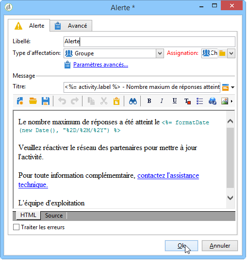

# Alerte{#alert}

Une activité **Alerte** envoie un message à un groupe d’opérateurs et d’opératrices. Son fonctionnement est le même qu’une activité de type validation, mais ici, aucune réponse n’est attendue.

Les alertes ne sont pas persistantes et ne sont donc pas visibles à partir de la console. Les opérateurs et opératrices du groupe affecté doivent avoir une adresse e-mail complète pour recevoir la notification. La configuration de cette activité est similaire à celle d’une **Approbation**. Le modèle de diffusion par défaut utilisé pour alerter les opérateurs et opératrices est « alertAssignee ».
