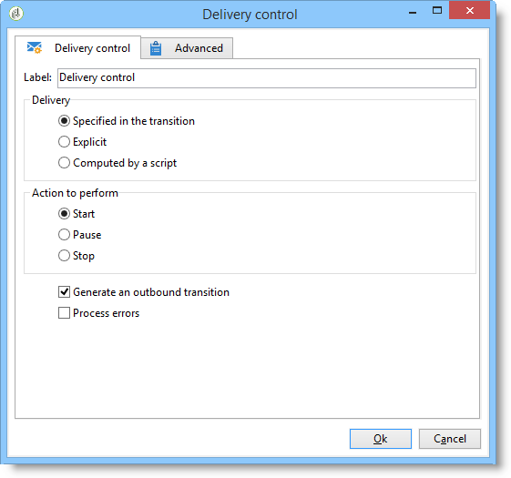

# Agir sur une diffusion{#delivery-control}

Une action de type **Agir sur une diffusion** permet de démarrer, mettre en pause ou arrêter une diffusion.

Il peut s&#39;agir de la diffusion spécifiée par la transition, d&#39;une diffusion explicitement sélectionnée ou bien calculée par un script. Pour plus d&#39;informations, consultez la section [Diffusion](delivery.md).

Si vous sélectionnez **[!UICONTROL Démarrer]**, l’activité effectue toutes les étapes requises pour démarrer la diffusion (calcul de la cible, préparation du contenu, diffusion). Si certaines de ces étapes ont déjà été effectuées par une activité de workflow précédente, elles ne seront plus exécutées. Par exemple, si l’estimation de la cible a déjà été effectuée par une activité de type **[!UICONTROL Diffusion]** (voir [Diffusion](delivery.md)), l’activité **[!UICONTROL Agir sur la diffusion]** lancera les étapes restantes (préparation et diffusion du contenu).

Les options disponibles sont les suivantes :

* **[!UICONTROL Générer une transition sortante]**

  Crée une transition sortante qui sera activée à la fin de l’exécution. Vous pouvez choisir de récupérer la cible de la diffusion sortante ou non.

* **[!UICONTROL Traiter les erreurs]**

  Pour plus d&#39;informations, consultez la section [Erreurs de traitement](monitoring-workflow-execution.md#processing-errors).

## Paramètres d&#39;entrée {#input-parameters}

* deliveryId

Identifiant de la diffusion, si l&#39;action sélectionnée est **[!UICONTROL Spécifiée par la transition]**.
