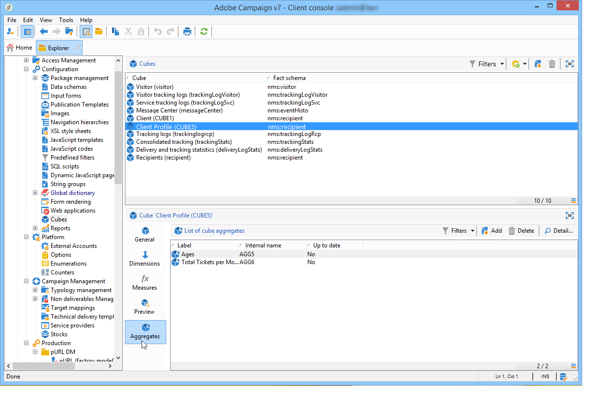
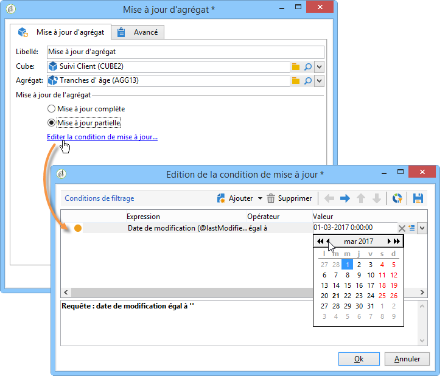
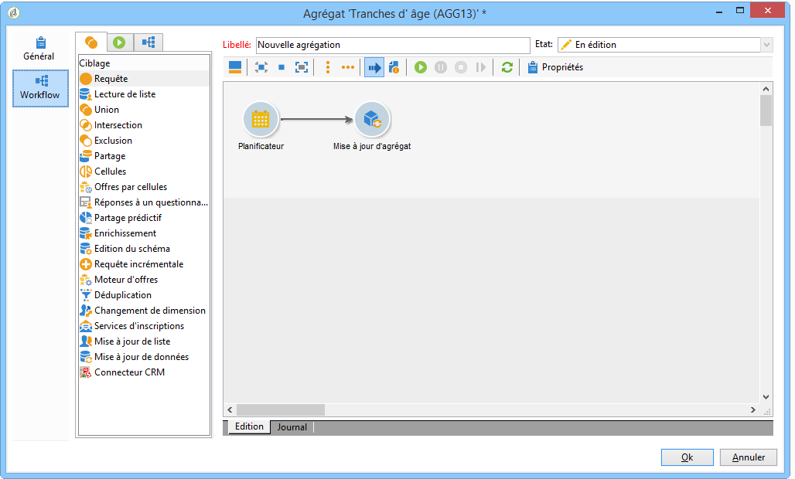

# Mettre à jour l’agrégat{#update-aggregate}

Les agrégats sont définis au niveau d’un cube, à des fins de création de rapports. Un onglet **[!UICONTROL Workflow]** est disponible lors de la configuration de l’agrégat.

Les agrégats sont utiles lorsque vous manipulez de grands volumes de données. Ils sont mis à jour automatiquement selon les paramètres définis dans la zone de workflow dédiée, afin d’intégrer les dernières données collectées dans les indicateurs.

Les agrégats sont définis au niveau du cube, dans l&#39;onglet correspondant.

L&#39;activité **[!UICONTROL Mise à jour d&#39;agrégat]** permet de choisir le mode de mise à jour à appliquer : complète ou partielle.

Par défaut, une mise à jour complète est exécutée lors de chaque calcul. Pour activer une mise à jour partielle, sélectionnez l’option correspondante et définissez les conditions de mise à jour.

**Bonne pratique** : une activité **[!UICONTROL Planificateur]** peut être utilisée pour définir la fréquence de mise à jour des calculs.

